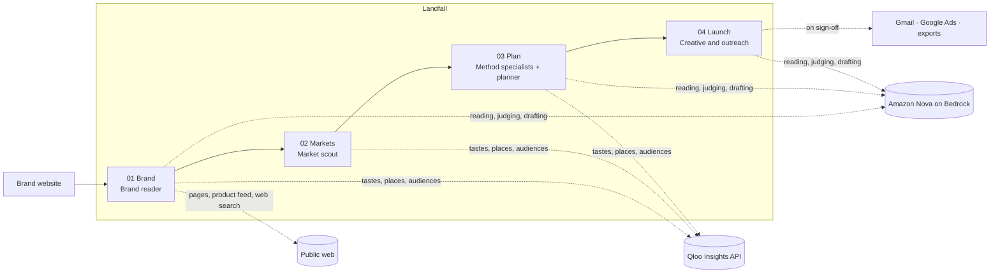
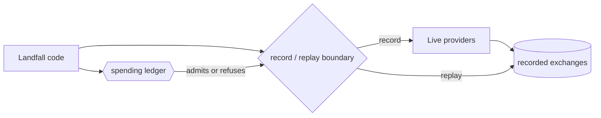

# Landfall

*Your international launch team. Find where your brand belongs worldwide.*

Death Wish Coffee sells bold, dark-roast coffee across the United States. Where should it go first abroad, and what
should it try there? Give Landfall `deathwishcoffee.com` and its team reads the site, checks every quote against the page
it came from, and asks Qloo which of 80 cities have an audience with the same cultural tastes. Qloo ranks Monterrey
first of 43 candidate cities, citing places that audience already goes to. Landfall's planner then builds a plan with one
local creator as the main test, with local Google Search ads beside it: US$9,800 of a US$10,000 ceiling, every cost
line labeled as an estimate. The Launch page shows the Spanish ads and the creator message exactly as they would go
out, and nothing leaves until the founder signs it off.

That is the product: a brand's website in, a sourced brief, a recommended first city with its reasons, an entry plan
within budget, and a launch kit ready to send. The founder makes every call that matters.


## How it works



**Brand.** The Brand reader opens the site (robots.txt respected), its product, about, stockist and shipping pages, the
store's own product feed, and a few grounded web searches. Amazon Nova 2 Lite drafts facts, each with a verbatim quote;
code checks that the quote exists on the page it cites, and a second model call judges whether the quote supports the
claim. What survives becomes an editable brief, with every fact linked to its source.

**Markets.** Landfall matches the brand to its Qloo entity (or builds a profile of Qloo tags the founder confirms), then
asks Qloo once per city across 80 cities which places the brand's audience is drawn to. A deterministic ranking
combines Qloo's ranking with the founder's goal, shared language, trade blocs and working hours, and leaves out cities
where the brand already sells. The founder sees one recommended city, two alternatives and the reasons for each.

**Plan.** Method specialists research retail, pop-up, creator, community and digital leads in the chosen city, each
against its own sources. A strategist combines the strongest methods into a plan within the founder's ceiling. Code,
not the model, sizes every cost line, converts currencies at dated ECB rates, and labels each line as an estimate,
an assumption or unknown.

**Launch.** Landfall drafts the messages, ads and shelf materials in the city's language, with mockup images. Each item
shows exactly what will be sent. Signed-off emails go through the founder's connected Gmail, and Google Ads campaigns
are created paused; everything can also be exported.



Every provider exchange passes one record/replay boundary (`landfall/cassette.py`), keyed by a hash of the exact
request. A recorded run replays through current code with no credentials, and every paid call is admitted by a ledger
against configured caps before it is made.

## Run locally

### Prerequisites

- Python 3.12 (`pyproject.toml` requires `>=3.12,<3.13`; verified on 3.12.12) and [uv](https://docs.astral.sh/uv/)
  (verified on 0.11.7).
- Node.js 20 or newer with npm (verified on Node 25.2.1).
- Free local port `8003` for the recorded runs, `8000` for live mode.
- For live mode only: a Qloo Insights API key and server URL, and AWS credentials with Amazon Bedrock access to Nova
  2 Lite and Nova Pro in `us-east-1` (see [Live mode](#live-mode)).

### Install

```bash
git clone https://github.com/markbrazinski/qloo-landfall.git
cd qloo-landfall
make setup
```

`make setup` runs `uv sync`, `npm install` in `web/`, and installs Playwright's Chromium for the browser checks.

The fastest proof the code works, with no configuration and no credentials:

```bash
make test
```

```text
630 passed, 23 skipped in 578.08s (0:09:38)
```

`make test` builds the frontend first, then runs the API, replay and browser tests (about ten minutes). The
skipped tests replay live captures kept outside the repository; they skip rather than fail.

### Start

```bash
make replay
```

```text
INFO:     Uvicorn running on http://127.0.0.1:8003 (Press CTRL+C to quit)
```

`make replay` builds `web/` and serves the app in replay mode: no provider calls, no `.env`, nothing sent.

### Health check

```bash
curl -s http://localhost:8003/api/session
```

```json
{"track":"demo","grant_kind":null,"demo_cases":["tidewell"]}
```

### Try it

1. Open [http://localhost:8003](http://localhost:8003).
2. **Tidewell** is selected under "Choose a brand". Press the start button below it.
3. Watch the Brand reader open `tidewell.example`, read its products, about, stockist and shipping pages, and check
   each quote against its page. Press **See the brief**: every fact links to the page and quote it came from, and each
   can be corrected.

Tidewell is a fictional sparkling-tea brand whose site and brand read ship in `fixtures/synthetic/`. The recorded run
covers the Brand stage; Markets, Plan and Launch run as live research.

### Live mode

```bash
cp .env.example .env
```

Fill in at least:

```dotenv
qloo_server=https://<your Qloo API host>
api_key=<your Qloo API key>
AWS_PROFILE=<a profile with Bedrock access>   # or leave unset to use AWS's normal credential chain
AWS_REGION=us-east-1
```

```bash
make dev
```

Open [http://localhost:8000](http://localhost:8000) and enter any brand's website.

- **AWS permissions:** `bedrock:InvokeModel` (the Converse API) on the `us.amazon.nova-2-lite-v1:0` and
  `us.amazon.nova-pro-v1:0` inference profiles, with model access enabled for Nova 2 Lite and Nova Pro. Grounded web
  search uses Nova's `nova_grounding` tool. Without `gemini_api_key`, mockup images use Stability on Bedrock.
- **Cost:** Nova 2 Lite is US$0.00033 per 1K input and US$0.00275 per 1K output tokens, Nova Pro US$0.0008 and
  US$0.0032, and each grounded search US$0.03. A full run from website to Launch costs about US$1–1.5 in Bedrock and
  a few hundred Qloo requests (the Markets scan alone asks Qloo once per city across 80 cities). Every action that
  calls a paid provider shows its estimate first.
- **Caps:** spending stops before it happens at US$75 of Bedrock, 2,500 Qloo requests and 3,000 page fetches by
  default; change them with the `LANDFALL_CAP_*` settings. `make usage` prints spend and request counts so far.
- **Recording:** live exchanges are written to `live-captures-private/` (gitignored), which is what lets a run be
  replayed later.

Optional providers (mockup images with Gemini, creator discovery with Influencers.club, YouTube, and delivery through
Gmail and Google Ads) are listed with every setting in [docs/SETUP.md](docs/SETUP.md).

### Troubleshooting

- **`The config profile (…) could not be found`:** `AWS_PROFILE` names a profile that isn't in `~/.aws/config`. Fix the
  name or remove the line to use the default credential chain.
- **A step fails because the recording doesn't cover it:** the app is in replay mode (`make replay`) and the step
  needs live research. Use `make dev` with a filled-in `.env`.
- **`Address already in use`:** another process holds port 8003 or 8000. Stop it, or run the same `uvicorn` command
  from the `Makefile` with another `--port`.
- **A blank page or 404 at `/`:** the frontend isn't built. Run `make web`.
- **`usd cap reached` or `qloo` cap messages:** a spending cap was hit. Raise the matching `LANDFALL_CAP_*` value in
  `.env` if you mean to spend more.

### Shutdown

Press Ctrl-C in the terminal running `make replay` or `make dev`. Projects live in SQLite under `.landfall/`
(`replay.db` for replay, `landfall.db` for live); delete a file to start fresh.

## Deploy

`deploy/` holds a single-instance AWS deployment: an EC2 `t4g.small` behind CloudFront, with SQLite backed up to S3 and
secrets in SSM Parameter Store (about US$0.58 a day).

1. `deploy/provision.sh`, run once in AWS CloudShell as an IAM administrator, creates the instance, CloudFront
   distribution, S3 bucket, SSM parameters, IAM role and a budget alert, and prints the site address.
2. `deploy/release.sh <commit>`, run from your machine, builds that commit, uploads it, restarts the service and
   checks its health; `--rollback` switches back to the previous release and `--logs` shows the service log.
3. `deploy/teardown.sh` takes a final backup and removes everything `provision.sh` created.

## Technologies and dependencies

- **Amazon Nova 2 Lite** (`us.amazon.nova-2-lite-v1:0`) on Amazon Bedrock reads sites, researches cities and proposes
  plans; **Nova Pro** (`us.amazon.nova-pro-v1:0`) writes and checks ad copy. Called through
  **Strands Agents 1.62.0** and **boto3 1.43.118**.
- **Qloo Insights API**: entity search, tags, audiences and per-city place recommendations.
- **Python 3.12** with **FastAPI 0.162.0**, **Uvicorn 0.54.0** and **sse-starlette 3.5.0** for the API and live
  progress; **SQLite** and an in-process durable task runner for projects and runs.
- **httpx 0.28.1** and **trafilatura 2.3.1** read pages; **Playwright 1.64.1** renders JavaScript-only sites and runs
  the browser checks; **pydantic 2.14.1** validates every model answer; **cryptography 50.0.2** encrypts connection
  tokens; **Pillow 13.0.0** composes mockup images.
- **React 19.3.1**, **Vite 7.3.7** and **TypeScript 5.9.3** for the web app; **d3-geo 3.1.1**,
  **topojson-client 3.1.0** and **world-atlas 2.0.2** draw the world map.
- **pytest 9.1.1** and **pytest-asyncio 1.4.0** for the test suite.
- Optional: Gemini image generation, Influencers.club, the YouTube Data API, the Gmail API and the Google Ads API.

## Repository structure

```text
landfall/             API (app.py), task runner, ledger, record/replay boundary (cassette.py)
  brand.py            Brand reader: pages, product feed, enrichment, quote checks, the brief
  identity.py         Qloo entity match and the editable tag profile
  scan.py ranking.py  the 80-city Qloo scan and the deterministic ranking
  research.py         city research; specialist.py: retail, pop-up, creator, community and digital leads
  strategist.py       plan proposals; plans.py estimates.py money.py: cost lines, budgets and FX
  delivery.py         launch kit, sign-off and delivery; adapters/: Gmail, Google Ads
  mockups.py          ad and shelf mockup images
  data/               80-city catalog, countries, gazetteer, platforms, templates, fonts
web/src/              React app: Entry, Brand, Markets, Plan, Launch and delivery pages
fixtures/synthetic/   Tidewell's site and recorded brand read, and sample creator data for tests
scripts/              browser walks, recording tools and reference-data builders
tests/                pytest suite
deploy/               AWS provisioning, release and teardown
docs/                 SETUP.md (every setting and command) and the README images
```

## License

Apache-2.0. See [`LICENSE`](LICENSE). Third-party material and data attributions (GeoNames, world-atlas, Inter) are
in [`NOTICE`](NOTICE).

## Scope

- **The founder decides; Landfall prepares.** Every city, plan and message is a proposal until the founder accepts or
  signs it off. Ads are created paused.
- **The model proposes; code decides.** Model answers are validated against schemas, every quote is checked against
  its page, Qloo ids must come from a recorded Qloo response, and code computes every number, currency conversion and
  ranking.
- **Qloo finds cultural fit, not demand.** Affinity says where an audience with the brand's tastes already goes; the
  plan's first test exists to measure demand.
- **Unknown stays unknown.** A blocked page or a missing price is shown as unknown, never filled in.
- **Spending is capped before it happens.** Every paid call is admitted by the ledger first, and every paid action
  shows its estimate before it runs.
- **One workspace per browser.** Projects belong to the browser session that created them.
